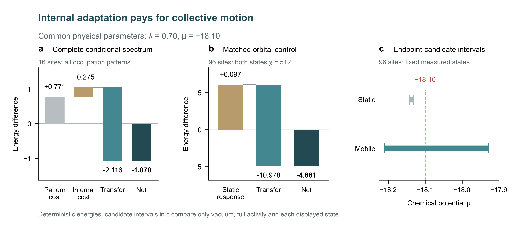

# 反面教材：把论文图排成网页页眉和三栏信息卡

配套的原始绘图脚本：[plot.py](../assets/negative-example/plot.py)。这是用于识别问题的归档样例，不是模板；阅读即可，不要运行来生成新图。

应避免重现的视觉处理：

- 画布上方的全图大标题和参数横幅、下方的灰色说明脚注，形成网页或演示文稿的页眉／页脚结构。
- 三个等宽面板各自再叠加大字母、面板标题和灰色副标题，层级过多，画面像并排信息卡。
- 标题区和说明区占据画布，数据图被挤在中间；文字比图形证据更先吸引视线。

修订时保留原有图表、数据关系和面板复杂度，重点整理图内文字的位置和权重，精修坐标轴与图例；合适的短说明可利用坐标轴内部的留白安放，不必挂在图外。
